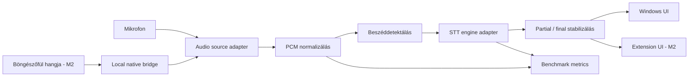
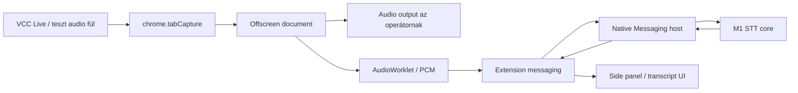

# Offline Realtime Speech-to-Text – projektterv

**Státusz:** tervezet / implementációra előkészítve  
**Projektazonosító:** `offline-realtime-stt`  
**Platform:** Windows 10/11 x64, később Chrome/Edge  
**Cél:** lokális, ingyenes, közel valós idejű beszédfelismerés, mérhető teljesítménnyel.

## 1. Cél és hatókör

A projekt teljesen független a Kobaqtól és a VCC Live-tól az első szakaszban. Két egymásra épülő, önállóan tesztelhető mérföldkő készül:

1. **M1 – Standalone Windows alkalmazás:** mikrofon → helyi STT → élő felirat a saját ablakban.
2. **M2 – Böngészőbővítmény:** kiválasztott Chrome/Edge fül hangja → ugyanaz a helyi STT motor → felirat a böngészőben; végül VCC Live kompatibilitási teszt.

Az alkalmazás a modellek előzetes letöltése után internet nélkül működjön. Nem használhat fizetős transzkripciós szolgáltatást, böngészős cloud speech API-t, OpenAI API-t vagy Kobaq-komponenst. Nem cél az értékesítési asszisztens, CRM, hangfelvétel-archiválás, fordítás, beszélőazonosítás vagy rendelési adatkinyerés. Az elsődleges nyelv magyar; a cseh, szlovák és román a későbbi összehasonlító tesztek célja.

## 2. Architektúra



A hangforrás, STT motor, feliratozás és mérési réteg ne függjön egymás konkrét implementációjától. M2-ben az audioforrást kell cserélni, nem a teljes alkalmazást újraírni.

### 2.1 Technológiai döntések

| Réteg | Első implementáció | Alternatíva |
|---|---|---|
| Nyelv | Python 3.11 x64 | C++ / C# későbbi optimalizáláshoz |
| Windows UI | PySide6 (Qt) | Tkinter egyszerűsített UI |
| Mikrofon | sounddevice / PortAudio | WASAPI natív capture |
| STT baseline | faster-whisper, CTranslate2, CPU INT8 | whisper.cpp CPU |
| Natív streaming jelölt | sherpa-onnx, igazolt magyar támogatású online modell | más többnyelvű streaming modell |
| VAD | Silero VAD ONNX vagy egyszerű energia alapú fallback | WebRTC VAD |
| Tesztelés | pytest, rögzített WAV tesztek | manuális élő tesztek |
| Csomagolás | PyInstaller one-directory | MSI a stabil verzióban |
| M2 extension | TypeScript, Manifest V3 | JavaScript |
| M2 kommunikáció | Chrome Native Messaging, helyi host | hitelesített loopback WebSocket |

A Python/PySide6 választás gyors prototipizálásra szolgál. A Qt LGPL feltételeit és a konkrét modellek súlyainak licencét terjesztés előtt ellenőrizni kell. A függőségeket és modellverziókat rögzíteni kell. A sherpa-onnx motor önmagában nem garantálja a magyar streaming támogatást; csak ellenőrzött modell kerülhet benchmarkba.

## 3. M1 – Standalone Windows alkalmazás

### 3.1 Felhasználói funkciók

- Mikrofon kiválasztása a Windows által elérhető eszközökből.
- Start / Stop, Clear, modellválasztás, nyelvválasztás (alapértelmezett `hu`).
- Folyamatos mikrofon jelszint és állapotjelzés: idle, loading, listening, processing, error.
- Görgethető, automatikusan követett feliratablak; ideiglenes szöveg halványan, végleges szöveg normál megjelenítéssel.
- Opcionális mindig legfelül ablak; másolás a vágólapra és explicit TXT export.
- Külön teljesítménypanel: CPU, RAM, RTF, partial/final késleltetés, queue depth, dropped frames.
- Hangfelvétel és transcript automatikus lemezre mentése alapértelmezetten kikapcsolva.
- Modell hiánya esetén egyértelmű hiba; külön opcionális modelltelepítő, amely hálózatot csak explicit kérésre használ.

### 3.2 Audio pipeline

1. Mikrofon rögzítése natív mintavétellel (tipikusan 44,1/48 kHz); mono konverzió és állapottartó resampling 16 kHz-re.
2. Feldolgozási formátum: 16 kHz mono float32, szükség esetén PCM16 az adapterhatáron.
3. 20–30 ms audio frame-ek; callback csak bounded queue-ba írjon, ne futtasson STT-t, ne blokkoljon.
4. VAD: induló konfiguráció 250 ms pre-roll, 400–700 ms végponti csend, maximum 10–15 s beszédszakasz; paraméterek mérés alapján finomítandók.
5. STT külön workerben; modell egyszer betöltve, warm-up a mérés előtt.
6. Whisper baseline: 0,5–1 s frissítési ciklus, gördülő 3–8 s ablak, átfedéssel; véglegesítés VAD végpontnál vagy stabil prefix alapján. Ezek hangolási kezdőértékek, nem garantált késleltetés.
7. A Whisper nem natív streaming: az ismételt dekódolás többletterhelését mérni kell. Ha a worker foglalt, elavult partial munkát el kell dobni, de a final szegmens prioritást kapjon.
8. Deduplikáció időbélyeg és stabil prefix alapján; final esemény nem változhat és nem duplikálódhat.
9. Túlterhelés esetén explicit dropped-frame és backlog jelzés; nincs korlátlan memóriafelhalmozás.
10. Stop esetén a fennmaradó szegmens véglegesítése korlátozott várakozással; eszköz leválasztásakor hiba és újraindítási lehetőség.

### 3.3 Motor interfész

```python
class SpeechEngine(Protocol):
    def load(self, config: EngineConfig) -> None: ...
    def push_audio(self, frame: AudioFrame) -> list[TranscriptEvent]: ...
    def flush(self) -> list[TranscriptEvent]: ...
    def reset(self) -> None: ...
    def close(self) -> None: ...
```

Az adapter feladata a streaming vagy ablakos működés elrejtése. A UI csak eseményeket kap; nem futtathat dekódolást a UI szálon.

```json
{
  "schema_version": 1,
  "session_id": "uuid",
  "segment_id": "uuid",
  "revision": 3,
  "source": "microphone",
  "language": "hu",
  "type": "partial",
  "audio_start_ms": 1200,
  "audio_end_ms": 3800,
  "text": "Jó napot kívánok",
  "emitted_monotonic_ms": 4210
}
```

A `final` esemény ugyanazon segment_id végleges változata. A session időalapja monoton óra; a falióra csak naplózáshoz használható. A modell által esetleg visszaadott confidence nem tekinthető kalibrált valószínűségnek.

### 3.4 Modellmátrix

| Jelölt | Cél | Megjegyzés |
|---|---|---|
| faster-whisper base multilingual INT8 | gyors baseline | első működő implementáció |
| faster-whisper small multilingual INT8 | pontosság | elsődleges összehasonlítás |
| whisper.cpp base/small Q5 vagy Q8 | CPU optimalizáció | azonos tesztanyaggal |
| sherpa-onnx online multilingual | natív streaming | csak ellenőrzött HU modell esetén |
| large-v3-turbo | erős gép / opcionális GPU | nem MVP-követelmény |

Mindig többnyelvű, nem `.en` modellt használjunk. A modellek fájljai, checksumjai, licence és letöltési forrása dokumentálandó; nagy súlyfájlokat ne commitoljunk Gitbe. GPU opcionális, CPU-only kötelező.

## 4. M2 – Chrome/Edge böngészőbővítmény

Csak M1 működő baseline-ja és benchmarkja után kezdődjön. A cél a kiválasztott fül kimenő hangja, nem az operátor mikrofonja. Az ügyfél hangja akkor különül el, ha a VCC fülön nincs mikrofon-visszajátszás vagy egyéb kevert hang.



### 4.1 Implementáció

- Manifest V3, Chrome/Edge modern verzió; Chrome 116+ kiindulási cél az offscreen stream-ID útvonalhoz, Edge külön validálandó.
- Minimális jogosultságok: `tabCapture`, `offscreen`, `nativeMessaging`, opcionálisan `sidePanel`. Ne kérjünk általános weboldal-hozzáférést az MVP-ben.
- Felhasználó kiválasztja a fület és explicit Start gombot nyom. Tab capture nem indítható tetszőleges fülön észrevétlenül.
- Service worker `getMediaStreamId`, offscreen document `getUserMedia`, AudioContext és AudioWorklet; a fül eredeti hangját visszavezetjük a kimenetre. Ellenőrizendő a headset routing és a kimeneti eszközválasztás; az AudioContext alapértelmezett kimenete eltérhet a VCC beállításától.
- A PCM csomagokat kötegelt, verziózott üzenetben továbbítjuk. Native Messaging JSON framing, base64 kódolás és korlátozott méretű csomagok; mérendő a többletterhelés. A natív host stdout kizárólag protokollra használható, napló stderr-re.
- A natív host Windows registry manifestje engedélyezze kizárólag a saját extension ID-t. A host indítsa vagy érje el a helyi STT core-t, ne legyen adminjog szükséges futás közben.
- Side panelben jelenjen meg a partial/final szöveg; ha nem támogatott, külön extension ablak. VCC DOM módosítása nem szükséges.
- Stop, tab bezárása, track ended, host crash, worker restart és böngésző újraindítás esetén erőforrás-felszabadítás és tiszta session reset.
- A capture útvonal meghibásodása nem szakíthatja meg a telefonhívást; ellenőrizni kell a normál hangkimenet helyreállását. Ha ez nem biztosítható, vizsgálandó a WASAPI loopback fallback (eszközszintű, esetleg kevert hang), vagy Windows process-loopback (folyamatszintű, nem garantáltan fül-specifikus).

### 4.2 Tesztelési sorrend

1. Lokális HTML audiolejátszó ismert WAV fájllal, hálózat nélkül.
2. Chrome és Edge, több fül, másik fülön lejátszott hang kizárása.
3. Headset és hangszóró, USB és Bluetooth, output device váltás.
4. VCC Live teszthívás engedélyezett tesztkörnyezetben: ügyfélhang, csengőhang, értesítés, némítás, tartás, hívásváltás.
5. Hosszú hívás, böngészőbővítmény vagy natív processz hibája, gyors újraindítás.

A VCC Live kompatibilitása nem tekinthető igazoltnak a tényleges teszthívás előtt. A VCC szolgáltatás maga természetesen igényel hálózatot; az STT nem.

## 5. Benchmark és minőségmérés

### 5.1 Tesztkörnyezet

Legalább három eltérő teljesítményű Windows x64 gép: gyengébb 4 magos / 8 GB RAM, közepes i5 / 16 GB, erősebb modern i7/Ryzen / 16–32 GB. Ezek kategóriák, nem minimális garantált követelmények. Rögzíteni kell CPU pontos típusát, fizikai/logikai magokat, RAM-ot, OS-t, energiagazdálkodást, modellhash-t, backendverziót, threads számot, VAD és ablakparamétereket. Teszteljünk 2/4/8 inference thread beállítást az elérhető magok szerint.

### 5.2 Reprodukálható tesztanyag

- Minimum 30 perc magyar, kézzel ellenőrzött referenciaátirattal; tiszta mikrofon és telefonminőségű (8 kHz, kodekhatású, zajos) változat.
- Külön legalább 50 rendelési adatot tartalmazó mondat: nevek, címek, számok, terméknevek, korrekciók.
- Rövid és hosszú mondatok, szünetek, gyors beszéd, háttérzaj, csend.
- Valós idejű WAV replay ugyanazon pipeline-ba 20 ms időzített blokkokkal; ne csak fájlfeldolgozási sebességet mérjünk.
- Minden konfiguráció legalább három futás, warm-up külön; egy 30 perces és egy 8 órás stabilitási futás a kiválasztott konfigurációval.
- Valós mikrofonteszt külön: az eszközlatencia és emberi beszéd variabilitása miatt nem helyettesíti a reprodukálható replay-t.
- Tesztanyag licencelt vagy saját, hozzájárulással készült; személyes adatok nélküli mintákat commitoljunk.

### 5.3 Mérőszámok és átvételi célok

| Metrika | Definíció | Pilot cél (nem garantált) |
|---|---|---|
| RTF | dekódolási falióra / feldolgozott audio másodperc; ismételt ablakok munkája külön mérve | < 0,7 a célgépen |
| First partial latency | első beszédkezdet → első nem üres partial UI | p95 ≤ 2 s |
| Final latency | annotált mondatvég → final UI | p95 ≤ 3 s |
| CPU | app + worker processzek, teljes gépkapacitásra normalizálva | átlag ≤ 50% közepes gépen |
| RAM | teljes processzfa peak working set | ≤ 2,5 GB base/small cél |
| WER | (substitutions + deletions + insertions) / referenciaszavak | ≤ 20% tiszta HU; ≤ 30% telefonos HU |
| CER | karakterhibaarány, egységes normalizálással | riportálandó |
| Kritikus adatok | pontosan egyező normalizált mezők / referencia mezők | ≥ 90% pilot cél |
| Dropped audio | elveszett frame-ek / összes frame | 0 normál terhelésnél |
| Stabilitás | crash, queue növekedés, memória trend | 8 óra crash nélkül |

A latency UI-megjelenítéskor mérendő, nem pusztán modell-visszatéréskor. A replay referencia beszédkezdet/vég annotációjával mérjük; VAD végponti idő külön adat. A WER normalizálás legyen rögzített (kisbetű, írásjelek kezelése, ékezetek megtartása), számokhoz külön mezőszintű normalizálás. A p50/p95/p99 mellett elemszámot is rögzítsünk. RTF önmagában nem igazolja a realtime működést: backlog, CPU és késleltetés együtt dönt.

### 5.4 Riport és offline bizonyítás

Minden futás JSONL metrikafájlt és összesítő CSV/Markdown riportot adjon, transcript csak külön opt-in esetén. Ajánlott oszlopok: run_id, hardware_id, model, quantization, threads, language, test_id, rtf, partial_p50_ms, partial_p95_ms, final_p95_ms, cpu_mean_pct, cpu_p95_pct, ram_peak_mb, wer, cer, field_accuracy, dropped_frames, max_queue_ms, crash_count.

A már telepített modellel internetkapcsolatot lekapcsolva futtassuk M1 mikrofon- és replay-tesztjét, M2-nél helyi audiofüllel. Ellenőrizzük, hogy nincs külső DNS/HTTP forgalom; a böngésző saját háttérforgalma elkülönítendő az extensiontől. Sem telemetria, sem automatikus modellletöltés ne legyen futás közben.

## 6. GitHub repository struktúra

```text
offline-realtime-stt/
├── README.md
├── PROJECT_PLAN.md
├── LICENSE
├── THIRD_PARTY_NOTICES.md
├── pyproject.toml
├── requirements.lock
├── .gitignore
├── .github/workflows/ci.yml
├── configs/default.toml
├── models/manifest.json
├── src/offline_stt/
│   ├── audio/             # microphone, replay, resampler, VAD
│   ├── engines/           # protocol, faster_whisper, whisper_cpp, sherpa
│   ├── pipeline/          # queue, session, stabilization, events
│   ├── metrics/
│   ├── ui/
│   └── __main__.py
├── extension/             # M2: manifest, service worker, offscreen, worklet, UI
├── native_host/           # M2: protocol, registry install, bridge
├── scripts/               # model download, benchmark, package
├── tests/unit/
├── tests/integration/
├── tests/fixtures/        # small non-sensitive audio
├── benchmarks/results/
└── docs/                  # architecture, setup, benchmark, decisions
```

Javasolt projektlicenc MIT, ha nyílt forráskódú terjesztés a cél; végleges licenc a tulajdonos döntése. Harmadik fél kódja és modellje saját licenc alatt marad. Git ignore: model weights, venv, build, private audio/transcripts, secrets. Windows CI: lint, typecheck, unit tesztek, kis replay integration test; teljes modellbenchmark manuális vagy dedikált runneren. A kiadások verziózott ZIP/installer csomagok legyenek, modellcsomag külön checksumokkal.

## 7. Fejlesztési backlog

### M1 – standalone

- [ ] STT-001 Repo bootstrap, README, dependency lock, CI, konfiguráció (3–5 h)
- [ ] STT-002 Mikrofon enumeráció, capture, resampling, replay adapter (5–8 h)
- [ ] STT-003 Faster-whisper baseline, local model manager, warm-up (5–8 h)
- [ ] STT-004 VAD, bounded queue, partial/final, deduplikáció (8–14 h)
- [ ] STT-005 Windows UI, jelszint, transcript, controls (5–8 h)
- [ ] STT-006 Metrics, replay benchmark, CSV export (6–10 h)
- [ ] STT-007 Alternatív motorok összehasonlítása (6–12 h)
- [ ] STT-008 Offline teszt, packaging, dokumentáció, hibajavítás (6–10 h)

**M1 összesen: 44–75 óra.** A működő mikrofonos baseline a 001–005 feladatok után már használható, de még nem tekinthető validált benchmarknak.

### M2 – extension

- [ ] STT-101 MV3 extension, explicit capture, offscreen, audio routing (8–14 h)
- [ ] STT-102 Native Messaging host, telepítő, protocol tests (8–14 h)
- [ ] STT-103 Transcript UI, session és stop/error lifecycle (5–9 h)
- [ ] STT-104 Chrome/Edge és eszközkompatibilitás, VCC teszthívás (8–14 h)
- [ ] STT-105 M2 benchmark, stabilitás, packaging, dokumentáció (6–12 h)

**M2 összesen: 35–63 óra.** Együtt 79–138 mérnöki munkaóra, tervezési becslés. A tényleges VCC capture hibái vagy újabb motorintegráció külön tartalékot igényelhetnek.

## 8. Költségek

20 000 Ft/óra tervezési mérnöki díjjal, nettó:

| Szakasz | Munkaóra | Költség |
|---|---:|---:|
| M1 | 44–75 | 880 000–1 500 000 Ft |
| M2 | 35–63 | 700 000–1 260 000 Ft |
| Összesen | 79–138 | 1 580 000–2 760 000 Ft |
| 20% tartalékkal | – | 1 896 000–3 312 000 Ft |

Saját/Codex-támogatott fejlesztésnél ez munkaérték, nem feltétlenül külső kiadás. Az AI-val elérhető gyorsulás nincs beárazva, mivel nem mért. Helyi STT API-díj: 0 Ft. A kiválasztott modell és függőségek megfelelő kereskedelmi licence esetén nincs használatarányos licencdíj. Meglévő gépeket feltételezünk; hardverfrissítés, kódaláírás, esetleges terjesztési díj nincs benne.

Többletáram képlete: `gépek × többlet_watt / 1000 × aktív_óra/hó × Ft/kWh`. Példa: 20 gép, 10 W többlet, 176 óra/hó, 70 Ft/kWh → 2 464 Ft/hó. Ez feltételezés, a tényleges fogyasztást mérni kell.

## 9. Biztonság és adatvédelem

- Mikrofon és tab capture csak explicit felhasználói indítás után, folyamatos látható állapotjelzéssel.
- Alapértelmezésben audio és transcript memóriában, Stop után törlés; export kizárólag tudatos művelet.
- Nincs cloud, telemetry, API kulcs, külső hálózati endpoint; natív host csak engedélyezett extensiont fogadjon.
- Naplókban nincs beszélgetésszöveg vagy nyers hang alapértelmezetten.
- Valódi ügyfélbeszélgetés előtt szükséges vállalati jóváhagyás, adatvédelmi jogalap, tájékoztatás, adatminimalizálás és megőrzési szabályok ellenőrzése.
- Modellek és telepítők integritásellenőrzése; függőségek sérülékenység- és licencellenőrzése.

## 10. Definition of Done és döntési kapuk

**M1:** tiszta Windows gépen telepíthető; offline mikrofonos magyar felirat; partial/final működés; replay benchmark; legalább három gépkategórián reprodukálható riport; ismert hibák dokumentálva. Ha a célértékek nem teljesülnek, kisebb modell, thread és VAD hangolás vagy alternatív motor következik, mielőtt M2 elindul.

**M2:** M1 motor változatlan interfésszel újrahasznosítva; kiválasztott fül hangja feliratozható; nincs észlelhető hangkimaradás vagy routing hiba a jóváhagyott eszközkonfigurációkban; offline helyi audio teszt; VCC teszthívás; böngésző/host crash helyreállás; benchmark összevetés M1-gyel.

## 11. Hivatkozások és ellenőrzendő döntések

- faster-whisper: https://github.com/SYSTRAN/faster-whisper
- whisper.cpp: https://github.com/ggml-org/whisper.cpp
- sherpa-onnx: https://github.com/k2-fsa/sherpa-onnx
- Silero VAD: https://github.com/snakers4/silero-vad
- Chrome tabCapture: https://developer.chrome.com/docs/extensions/reference/api/tabCapture
- Chrome offscreen: https://developer.chrome.com/docs/extensions/reference/api/offscreen
- Native Messaging: https://developer.chrome.com/docs/extensions/develop/concepts/native-messaging
- Windows loopback: https://learn.microsoft.com/en-us/windows/win32/coreaudio/loopback-recording

A hivatkozások implementációs kiindulópontok; az aktuális verziók, licencfeltételek, magyar streaming modellek és böngésző-kompatibilitás a fejlesztés kezdetén ellenőrizendők. Ez a dokumentum nem kész alkalmazás és nem mért teljesítményriport. A kiválasztott stack és célértékek javaslatok, a benchmark eredménye felülírhatja őket.
