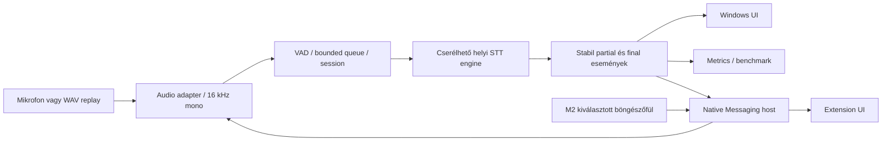

# Architektúra és könyvtárváz

| Könyvtár | Felelősség | Főjegy |
|---|---|---|
| src/offline_stt/audio | Capture, resampling, WAV replay, VAD | #4, #6 |
| src/offline_stt/engines | SpeechEngine szerződés és helyi adapterek | #5, #9 |
| src/offline_stt/pipeline | Queue, session, események, stabilizálás | #6 |
| src/offline_stt/metrics | Terhelés, latency, minőségmérés | #8 |
| src/offline_stt/ui | PySide6 ablak és felhasználói vezérlés | #7 |
| configs, src/offline_stt/config.py | Teljes TOML-séma, validált immutable konfiguráció | #16 |
| models | Manifest, nem súlyfájlok | #5 |
| extension, native_host | M2 komponensek | #11–#13 |
| scripts | Modelltelepítés, benchmark, packaging | #5, #8, #10 |
| tests/unit, tests/integration, tests/fixtures | Célzott tesztek és kis, nem érzékeny minták | Az adott fejlesztési jegy |
| benchmarks/results | Mért, anonimizált összefoglalók | #8, #15 |

A konfigurációbetöltő, validáló CLI, a [mikrofon/WAV audioforrások](audio.md), a
[helyi CPU INT8 engine](engine.md), a [session pipeline](pipeline.md) és a #7 első
PySide6 ablak elkészült.
A capture callback korlátos pufferbe
ír; a 16 kHz mono átalakítás a pull olvasónál fut. Az engine `push_audio` metódusa
csak pufferel; a worker `preview`/`flush` hívása dekódol. A #6/#18/#19/#20 pipeline
külön spawn folyamatban, korlátos sorokon ütemez, revision/final eseményeket ad.
A részletes benchmark metrikák a #8 feladatai. A UI külön Qt-szálon indítja/leállítja
a sessiont, eseményeket és számlálókat olvas; a decoder_busy és a bemeneti dBFS
jelszint a session statisztikáiból jön. CPU/RAM és minőségi/késleltetési eredményeket
csak a benchmark mérhet hitelesen. A reader worker hívja az audioforrás read
metódusát; UI/capture callback nem dekódolhat. A session időalap monoton; a stabil
final esemény nem módosulhat és nem duplikálódhat.

A modellek, függőségek és böngésző API-k aktuális változatait implementációkor kell ellenőrizni; ez az ábra a terv szerinti irány.

