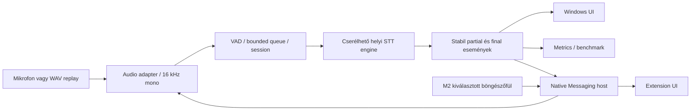

# Architektúra és könyvtárváz

| Könyvtár | Felelősség | Főjegy |
|---|---|---|
| src/offline_stt/audio | Capture, resampling, WAV replay, VAD | #4, #6 |
| src/offline_stt/engines | SpeechEngine szerződés és helyi adapterek | #5, #9 |
| src/offline_stt/pipeline | Queue, session, események, stabilizálás | #6 |
| src/offline_stt/metrics | Terhelés, latency, minőségmérés | #8 |
| src/offline_stt/ui | PySide6 ablak és felhasználói vezérlés | #7 |
| configs, src/offline_stt/config.py | Teljes TOML-séma, validált immutable konfiguráció | #16 |
| models | Manifest, nem súlyfájlok | #5 |
| extension, native_host | M2 komponensek | #11–#13 |
| scripts | Modelltelepítés, benchmark, packaging | #5, #8, #10 |
| tests/unit, tests/integration, tests/fixtures | Célzott tesztek és kis, nem érzékeny minták | Az adott fejlesztési jegy |
| benchmarks/results | Mért, anonimizált összefoglalók | #8, #15 |

A konfigurációbetöltő és validáló CLI elkészült; az audio/engine/pipeline/metrics/UI könyvtárak még helyőrzők. A SpeechEngine és TranscriptEvent szerződés részleteit a [forrásterv](../PROJECT_PLAN.md) §3.3, az implementációt #5 és #19 követi. VAD, queue és worker nem kötődhet a UI konkrét típusaihoz. A session időalap monoton; final esemény nem módosulhat és nem duplikálódhat.

A modellek, függőségek és böngésző API-k aktuális változatait implementációkor kell ellenőrizni; ez az ábra a terv szerinti irány.
